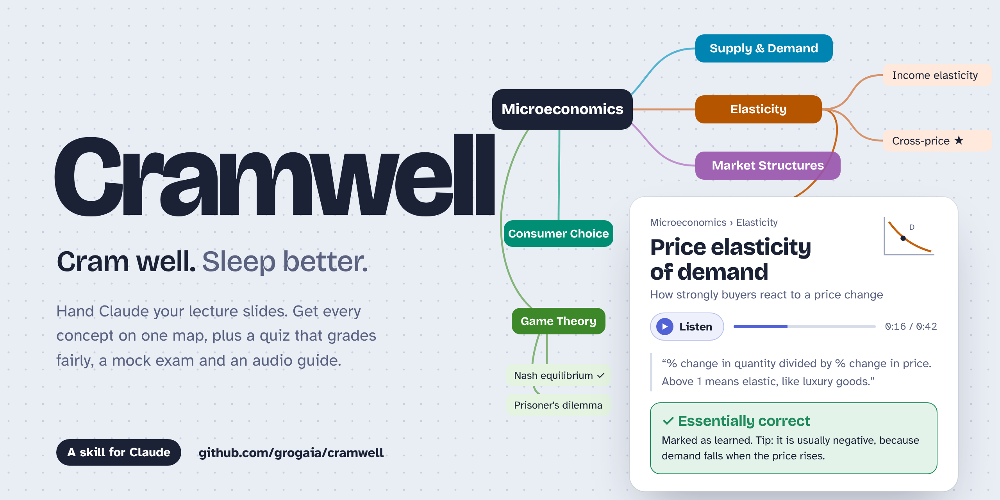

<p align="center">
  
</p>

# Cramwell

**Cram well. Sleep better.** Cramwell is a skill for [Claude](https://claude.ai) that turns your lecture
slides into one interactive study map: every concept of the course, organised by topic instead of by
session, with a quiz that grades your answers like a fair examiner.

## What you get

- **Concept map**: Every concept from your slides in one mindmap. Click a node for a plain-language explanation, formula, example and exam tip.
- **Sketches and comparisons**: Small diagrams for visual ideas, side-by-side tables for the pairs everyone mixes up.
- **Quiz mode**: Type or dictate your answer. Claude grades it against the lecture, marks it learned or weak, and you can object if it misread you.
- **Training hub**: A mock exam in your real exam format, small calculation drills, a weak-spot overview and guided lessons.
- **Audio guide** *(optional)*: A short spoken explanation for every concept, like a museum audio guide.
- **Everywhere**: Works on laptop and phone, and your progress syncs between them.

## Install

**Claude app (web, desktop, mobile)**
1. Download `cramwell.zip` from the [latest release](https://github.com/grogaia/cramwell/releases/latest).
2. In Claude, open **Settings**, go to the skills section and upload the ZIP.

**Claude Code**
```bash
git clone https://github.com/grogaia/cramwell.git
cp -r cramwell/cramwell ~/.claude/skills/
```
In Claude Code the result is a local HTML file. Features that need Claude inside the page (grading,
questions) switch to self-check mode.

## Use

Upload all your lecture slides (PDF or PowerPoint) and write:

> Make a Cramwell study map from these slides.

Claude asks a few questions about your exam: question types, how hard the calculations are, old exams
you might have, and whether you want audio. Then it builds the tool step by step. A first version is
usable early, and the extras follow. Ask for changes in the same chat.

**Tips**
- Upload *all* slides at once. Cramwell organises by concept, so it needs the full picture.
- Old exams or a topic list make the core concepts and the mock exam much more accurate.
- Quiz answers can be short bullet points, just like in a real exam.
- For the audio guide, allow `speech.platform.bing.com` in Claude's network settings. A Gemini API key
  is optional; upload it as a file and never paste it into the chat.

## Good to know

- **Your material stays yours.** Your study map contains content from your lecturer's slides. Keep it
  private or share it only with classmates from the same course.
- **Claude can make mistakes.** Cramwell checks its explanations against your slides, but if something
  looks off, compare it with the source.
- **Audio uses third-party text-to-speech services.** Their availability is not guaranteed.
- **Community project**, not affiliated with or endorsed by Anthropic. Provided as is and maintained
  when time allows. Issues and pull requests are welcome.

## Auf Deutsch

Cramwell ist ein Claude-Skill, der aus Vorlesungsfolien eine interaktive Lernlandkarte macht: alle
Konzepte in einer Mindmap, einfache Erklärungen, Skizzen, ein Abfragemodus mit fairer Bewertung durch
Claude, Probeklausur und auf Wunsch ein Audioguide. Installation: `cramwell.zip` aus dem Release
herunterladen und in den Claude-Einstellungen bei den Skills hochladen. Dann Folien hochladen und
schreiben: „Mach mir eine Cramwell-Lernkarte aus diesen Folien.“

## License

[MIT](LICENSE) © grogaia
